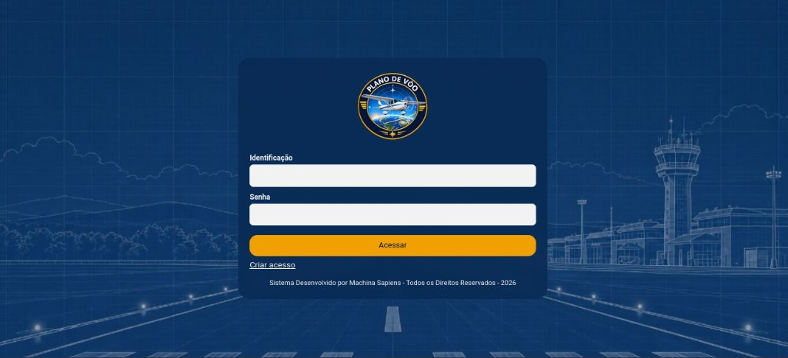
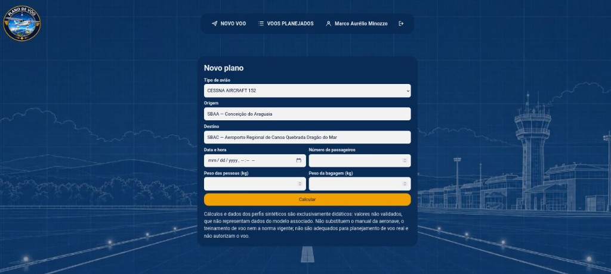
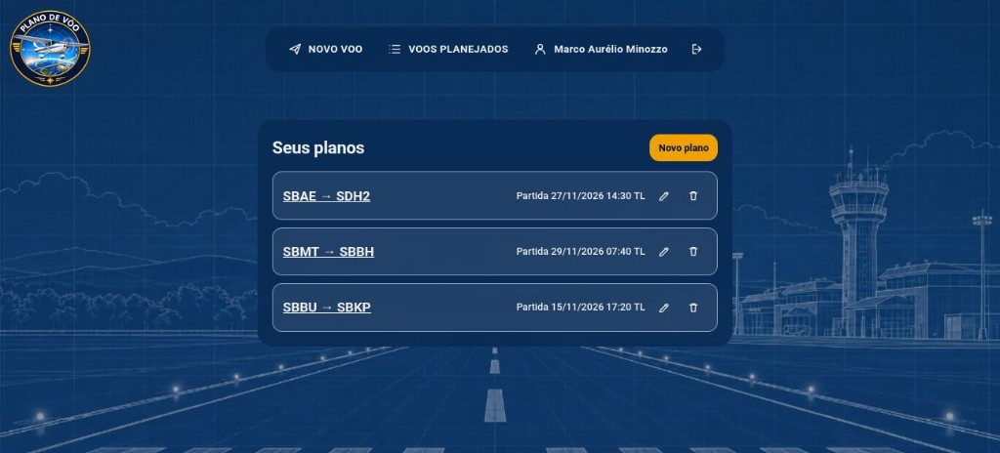
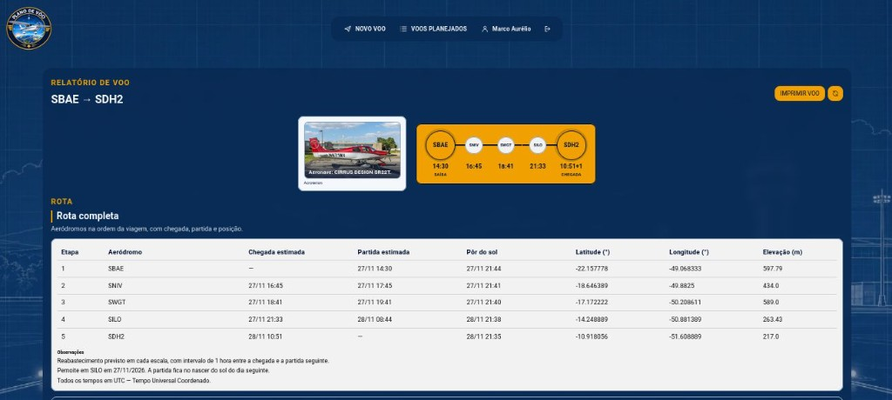

# Plano de voo

## I. O que é e para que serve

<p align="center">
  
</p>

O Plano de Voo é um aplicativo de planejamento de voo visual para avião de pequeno porte. O piloto informa de onde sai, para onde vai, quando pretende partir e qual aeronave usa. O servidor calcula a rota, inclusive com escalas quando o trecho não cabe no combustível de planejamento, e monta um relatório com tempos, combustível, peso, meteorologia e mapa.

O resultado é apoio didático ao planejamento. Não substitui o manual da aeronave, o treinamento de voo nem a norma vigente, e não autoriza o voo. Cada piloto vê somente os próprios planos.

A conta de navegação fica no servidor. A interface é em português, com unidade e fonte explícitas. Quando um dado não chega da fonte, o relatório marca indisponível em vez de completar o buraco com um valor estimado.

## II. Como instalar e requisitos

### Requisitos

- Python 3.10 ou mais novo
- PostgreSQL 16
- Node.js 20 ou mais novo e npm, somente para recompilar o CSS durante o desenvolvimento

A folha `static/css/tailwind.css` já vem no repositório. O npm só é necessário quando o estilo muda.

### Instalação

Na raiz do repositório, crie o ambiente virtual e instale as bibliotecas nele. Não use o Python do sistema.

```bash
python3 -m venv .venv
.venv/bin/pip install -r requirements.txt
```

As chaves e o endereço do banco ficam no ambiente ou no arquivo `.env`, fora do versionamento. Não grave senha nem chave no repositório. A lista das variáveis e o procedimento completo de carga estão em `documentacao/operacao.md`.

| Variável | Função |
| --- | --- |
| `DATABASE_URL` | PostgreSQL do produto, usado pela aplicação, pelo Alembic e pela carga |
| `SECRET_KEY` | Assina a sessão do piloto |
| `COOKIE_SECURE` | Use `1` fora de acesso local |
| `REDEMET_API_KEY` | Vento de área, satélite, reserva do radar e prioridade do TAF |
| `AISWEB_API_KEY` e `AISWEB_API_PASS` | Carta visual, pôr do sol e emenda do ROTAER |
| `OPENAIP_API_KEY` | Camada aeronáutica comunitária, com atribuição CC BY-NC 4.0 |
| `RAB_EXTRATO` | Extrato público vigente do Registro Aeronáutico Brasileiro, fora do repositório |

Sem essas chaves o serviço sobe. O plano abre e o dado correspondente aparece como indisponível.

Com o PostgreSQL em execução e o `.env` configurado:

```bash
.venv/bin/alembic upgrade head
.venv/bin/python -m servidor.semente
.venv/bin/python -m servidor.catalogo
.venv/bin/flask --app app:criar_app run
```

Abra a página inicial, cadastre um piloto com senha de pelo menos 8 caracteres e confirme o painel. A orientação que o piloto vê está em `documentacao/piloto.md`.

Para recompilar o CSS depois de alterar `static/css/input.css`:

```bash
npm ci
npm run css:build
```

## III. Como funciona

### Acesso

O piloto entra com identificação e senha. Quem ainda não tem acesso usa **Criar acesso**. Cinco recusas em 15 minutos bloqueiam a identificação por 15 minutos, sempre com a mesma mensagem de identificação inexistente. A sessão encerra ao sair e depois de 8 horas sem uso.



### Novo voo

Em **Novo voo** o piloto escolhe o tipo de avião, a origem, o destino, a data e a hora, o número de passageiros, o peso das pessoas e o peso da bagagem. **Calcular** envia esses dados ao servidor. A rota, os tempos e o combustível não são calculados no navegador.

Perfis sintéticos podem aparecer na lista de aeronaves. Eles servem só para exercício: os valores não foram validados e não representam o modelo associado.



### Voos planejados

**Voos planejados** lista os planos daquele piloto. Cada linha mostra a origem, o destino e a partida. Dali é possível abrir o relatório, editar ou apagar o plano.



### Relatório

O relatório reúne a foto ilustrativa da aeronave, o infográfico da saída, das escalas e da chegada, e a tabela da rota completa. A tabela traz chegada, partida, pôr do sol, latitude, longitude e elevação. As observações registram o reabastecimento previsto nas escalas, o pernoite quando a viagem muda de dia e o aviso de que os tempos estão em UTC.

Abaixo disso o relatório segue com os dados do plano, uma ficha por trecho, METAR, TAF, vento e o mapa da rota. **Imprimir voo** gera o PDF com a mesma viagem. O arquivo recebe o nome da sigla de saída, da sigla de chegada e da data da partida, por exemplo `SBAE-SDH2-27-11-2026.pdf`.


