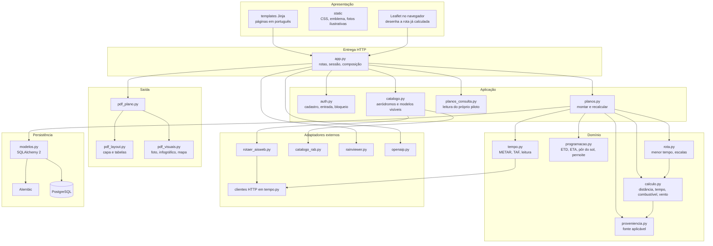
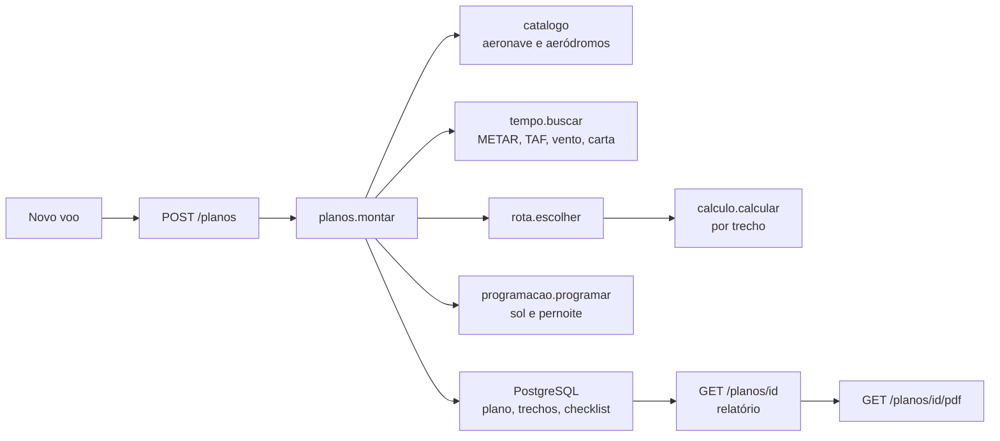
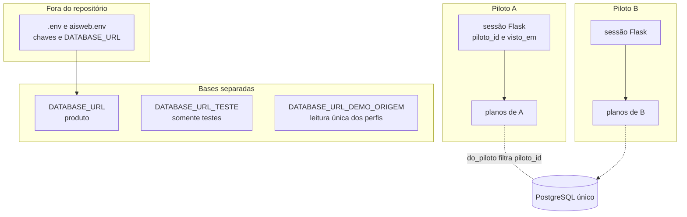
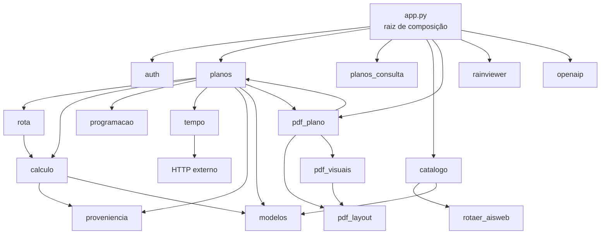

# Arquitetura do Plano de voo

Um processo Flask atende o piloto. O navegador só coleta a entrada e desenha o que o servidor devolve. Navegação, combustível, meteorologia, vento, carta e PDF são montados no servidor. O PostgreSQL é o único banco de piloto, aeronave, aeródromo e plano.

O produto é didático. O relatório não substitui o manual, o treinamento nem a norma, e não autoriza o voo.

## Camadas

| Camada | O que faz | O que não faz |
| --- | --- | --- |
| Apresentação | Formulário, lista, relatório, mapa e botão de PDF | Não calcula distância, tempo, combustível nem vento |
| Entrega HTTP | Autentica a sessão, escolhe o piloto e chama um módulo | Não guarda regra de rota dentro da rota Flask |
| Aplicação | Cria, recalcula, lista e apaga o plano do piloto logado | Não fala com o provedor meteorológico direto |
| Domínio | Rota, grandezas, programação solar e leitura de boletim | Não renderiza HTML nem PDF |
| Saída | Capa, tabelas, foto, infográfico e mapa do PDF | Não recalcula o plano |
| Adaptadores | AISWEB, RAB, REDEMET, AWC, RainViewer, OpenAIP, OpenStreetMap | Não decidem a rota quando a fonte falha |
| Persistência | Tabelas, migrações e a sessão SQLAlchemy | Não é acessada pelo navegador |

## Pedido de um plano

O mapa da tela pede as camadas só quando o piloto liga radar, satélite ou OpenAIP. Essas consultas não mudam a rota nem os números já gravados. **Atualizar relatório** chama `recalcular` e monta o plano de novo com os dados já gravados.

## Isolamento

| Fronteira | Como é mantida |
| --- | --- |
| Plano de outro piloto | `do_piloto`, `listar`, `apagar` e `marcar_item` filtram `piloto_id`. Plano ausente e plano alheio devolvem a mesma recusa |
| Senha | Hash do Werkzeug. A sessão guarda o identificador do piloto e o instante de uso, não a senha |
| Bloqueio de entrada | Cinco recusas em 15 minutos bloqueiam a identificação por 15 minutos, com a mesma mensagem de identificação inexistente |
| Sessão | Encerra ao sair e depois de 8 horas sem uso. Cookie HttpOnly |
| Segredo | `REDEMET`, `AISWEB`, `OPENAIP` e `SECRET_KEY` ficam no ambiente. O repositório não leva chave |
| Banco de teste | A suíte usa `DATABASE_URL_TESTE`. A importação dos perfis sintéticos lê a base legada e grava a de produto só depois de confirmar que são bases distintas |
| Falha de fonte | METAR, TAF, vento, carta, radar ou OpenAIP ausentes ficam indisponíveis. O servidor não inventa boletim nem completa com valor estimado |
| METAR regional | Só entra se a estação estiver a até 50 NM, e o relatório nomeia a estação observadora. Não é tratado como observação do aeródromo |
| Carta e OpenAIP | A carta WAC vem do AISWEB. O OpenAIP é camada comunitária, separada, com a licença CC BY-NC 4.0. Uma não substitui a outra |
| Perfil sintético | Os vinte perfis didáticos permanecem marcados como sintéticos. Não entram na lista factual do RAB e não são apresentados como dados do modelo |
| Cálculo | Fórmulas ficam em `calculo.py` e `rota.py`. O JavaScript do mapa só desenha coordenadas já gravadas |

## Acoplamentos

O acoplamento permitido desce da entrega para o domínio e daí para o banco. O navegador não acopla fórmula. O domínio não acopla HTML.

Acoplamentos que o desenho aceita:

- `app.py` é a única raiz que conhece rotas HTTP, sessão e a ordem das chamadas.
- `planos.py` orquestra domínio e gravação. É o único ponto que junta rota, meteorologia e programação solar num plano.
- `rota.py` depende de `calculo.py` para distância, tempo e combustível de cada trecho. Não conhece Flask nem PDF.
- `programacao.py` recebe uma função de consulta do sol. Quem chama é que liga essa função ao AISWEB.
- Os adaptadores devolvem estado `disponivel` ou `indisponivel`. A tela e o PDF só apresentam esse estado.

Acoplamentos que apertam o desenho e devem ser respeitados ao mudar o código:

- `planos.py` importa `trecho_limite` de `pdf_plano.py` na carga do módulo. `pdf_plano.py` importa formatadores de `planos.py` só dentro da função que monta o PDF. Essa ordem evita o ciclo na importação. Um import novo de `planos` no topo de `pdf_plano.py` quebra a carga.
- `calculo.py` recebe a classe `Aeronave` de `modelos.py`. A conta de voo conhece a forma da linha gravada, não só um dicionário.
- `tempo.py` junta a leitura do boletim e o cliente HTTP. Testes trocam o cliente por um `getter` injetado, sem rede.
- `pdf_visuais.py` busca o mapa no OpenStreetMap na hora de gerar o PDF. Se a rede falha, o mesmo módulo desenha a posição relativa. O relatório não depende do mapa para existir.
- `catalogo.py` grava aeródromo e aeronave na mesma sessão do produto. A carga do ROTAER e a do RAB seguem independentes: a falha de uma não publica um catálogo parcial da outra.

## O que atravessa a fronteira

| Entra | Fica no servidor | Sai |
| --- | --- | --- |
| Identificação, senha, origem, destino, hora, pesos | Hash, rota, trechos, grandezas, boletins, fontes | HTML do relatório e PDF `ORIGEM-DESTINO-DD-MM-AAAA.pdf` |
| Clique em radar, satélite ou OpenAIP | Validação da chave, do quadro e da licença | Tile ou indisponível, sem alterar o plano |
| Extrato RAB e emenda AISWEB, fora do pedido do piloto | Catálogo de aeródromos de avião e até 30 modelos factuais completos | Listas de origem, destino e tipo de avião |
